<div align="center">
  <h1>🧩 Re:Solve</h1>
  <p><strong>문제 풀이에서 스터디와 모의 코딩 테스트까지 이어지는 코딩 학습 플랫폼</strong></p>
  <p>
    <a href="https://resolve-frontend.backtoback.workers.dev/"></a>
    <a href="https://github.com/Back-To-Back-team-3/re-solve/tags"></a>
  </p>
  <p>
    <a href="https://resolve-frontend.backtoback.workers.dev/"><strong>서비스 바로가기</strong></a>
    ·
    <a href="#presentation"><strong>발표 자료</strong></a>
    ·
    <a href="https://github.com/Back-To-Back-team-3/re-solve/tags"><strong>버전 태그</strong></a>
  </p>
</div>

---

## 🧭 목차

- [📌 프로젝트 소개](#project-overview)
- [🎬 발표 자료와 시연](#presentation)
- [👥 팀원 소개](#team)
- [✨ 주요 기능](#features)
- [🔄 서비스 흐름](#service-flow)
- [🏗️ 시스템 아키텍처](#system-architecture)
- [🗃️ ERD](#erd)
- [📖 API 명세서](#api-spec)
- [🧰 기술 스택](#tech-stack)
- [⚙️ 핵심 기술](#core-technology)
- [🗂️ 프로젝트 구조](#project-structure)
- [🛠️ 개발자 안내](#developer-guide)
- [🏷️ 버전 태그](#version-tags)
- [📚 관련 문서](#related-docs)

---

<a id="project-overview"></a>

## 📌 프로젝트 소개

Re:Solve는 알고리즘을 연습하는 학습자와 과제를 운영하는 스터디를 위한 서비스입니다.

- **개인 학습** · 태그별 진단으로 현재 수준을 파악하고 같은 태그의 문제를 연습합니다.
- **스터디 운영** · 배정된 문제의 풀이 결과가 과제 진도로 이어져 구성원별 진행 상황을 확인할 수 있습니다.
- **실전 연습** · 스터디장이 문제와 배점을 골라 제한 시간이 있는 모의시험을 출제합니다.

---

<a id="presentation"></a>

## 🎬 발표 자료와 시연

- **최종 발표 자료** · PPTX 및 PDF
- **전체 시연 영상** · MP4

[GitHub Releases](https://github.com/Back-To-Back-team-3/re-solve/releases)

---

<a id="team"></a>

## 👥 팀원 소개

<table>
<thead>
  <tr><th>파트</th><th>담당 도메인</th><th>주요 역할</th><th>담당자</th></tr>
</thead>
<tbody>
  <tr>
    <td>플랫폼·인프라</td>
    <td><code>api-gateway</code><br /><code>notification-service</code><br /><code>integration-service</code></td>
    <td>요청 라우팅·AWS 배포<br />실시간 알림·GitHub 연동</td>
    <td align="center"><a href="https://github.com/LFCKJ"><br/><strong>김재환</strong><br/><sub>팀원 · @LFCKJ</sub></a></td>
  </tr>
  <tr>
    <td>문제·채점</td>
    <td><code>problem-service</code><br /><code>judge-service</code></td>
    <td>문제 회차·테스트 자산<br />코드 실행·비동기 채점</td>
    <td align="center"><a href="https://github.com/Siho-ily"><br/><strong>박현수</strong><br/><sub>팀원 · @Siho-ily</sub></a></td>
  </tr>
  <tr>
    <td>모의시험</td>
    <td><code>contest-service</code><br /><code>common-*</code></td>
    <td>출제·응시·마감·결과<br />백엔드 공통 모듈</td>
    <td align="center"><a href="https://github.com/bepo03"><br/><strong>전윤현</strong><br/><sub>팀장 · @bepo03</sub></a></td>
  </tr>
  <tr>
    <td>스터디·AI</td>
    <td><code>study-service</code><br /><code>ai-service</code></td>
    <td>스터디 가입·과제·진도<br />단계별 AI 힌트</td>
    <td align="center"><a href="https://github.com/r1nn-dev"><br/><strong>조하린</strong><br/><sub>팀원 · @r1nn-dev</sub></a></td>
  </tr>
  <tr>
    <td>회원·인증</td>
    <td><code>member-service</code></td>
    <td>로그인·회원 정보<br />태그 진단·레벨 갱신</td>
    <td align="center"><a href="https://github.com/rmi9394"><br/><strong>유명인</strong><br/><sub>팀원 · @rmi9394</sub></a></td>
  </tr>
</tbody>
</table>

---

<a id="features"></a>

## ✨ 주요 기능

**💻 개인 학습**

- **로그인과 실력 진단** · GitHub OAuth2로 로그인합니다. 태그별 진단을 시작하거나 이어 풀고 결과를 조회합니다.
- **문제 풀이와 채점** · 태그로 문제를 찾고 공개 예제나 직접 입력으로 코드를 점검합니다. 풀이를 제출하면 채점 결과를 확인할 수 있습니다.
- **학습 현황** · 태그별 레벨과 최근 제출 기록을 확인하고 제출 상세로 이동할 수 있습니다.

**👥 스터디 운영과 시험**

- **스터디 개설과 가입** · 스터디별로 즉시 가입이나 승인 후 가입을 설정하고 가입 요청을 처리합니다.
- **문제집 과제와 진도** · 문제집을 과제로 배정합니다. 배정된 풀이가 완료 조건을 충족하면 채점 결과를 구성원별 진도에 반영합니다.
- **모의 코딩 테스트** · 문제·배점·제한 시간을 설정합니다. 응시 중에는 예제를 실행하고 답안을 자동 저장하거나 직접 제출합니다. 응시 종료 시 서버의 미제출 저장본을 자동 제출하며 문항별 채점 결과를 조회할 수 있습니다.

**🔔 학습 지원과 연동**

- **AI 힌트 처리** · `study-service`에 힌트 요청·조회 로직, `ai-service`에 단계별 힌트의 비동기 생성 로직이 있습니다.
- **실시간 알림** · 스터디, 시험, 레벨 변경 등의 알림을 실시간으로 전달합니다. 사용자는 알림 수신 항목을 설정할 수 있습니다.
- **GitHub 연동** · 저장소와 자동 기록을 설정하면 지원하는 일반 문제의 정답 풀이를 연결한 저장소에 기록합니다.

**🛠️ 관리자 운영**

- **회원과 문제 관리** · 관리자 화면에서 회원 상태를 관리하고 문제 등록·수정과 공개 상태를 관리합니다.
- **채점 작업 관리** · 채점 작업 상태를 조회하고 복구 가능한 작업의 복구를 요청할 수 있습니다.

---

<a id="service-flow"></a>

## 🔄 서비스 흐름

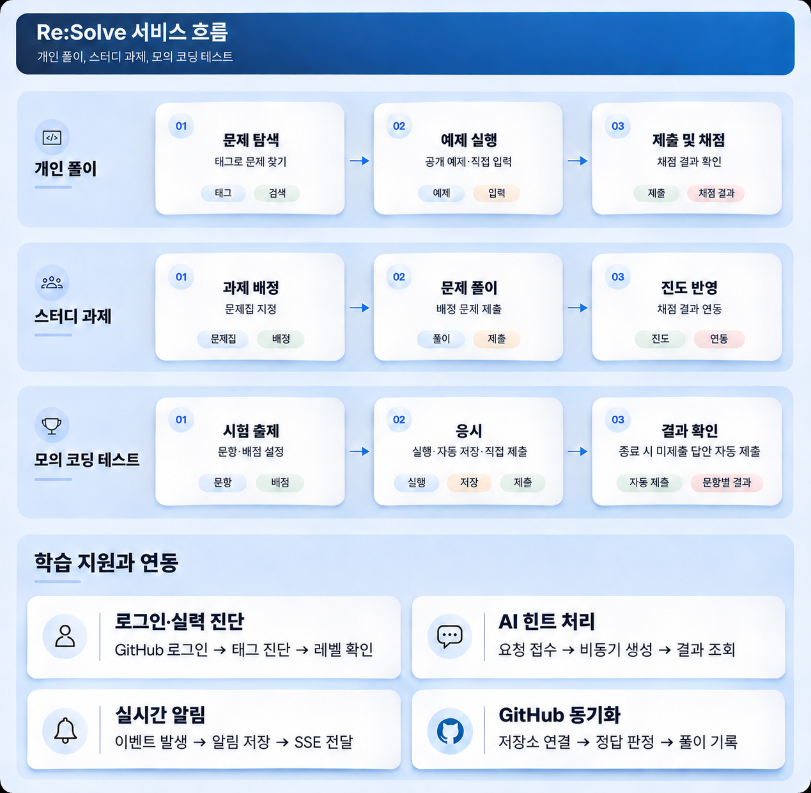

[서비스별 시퀀스와 상태 다이어그램](docs/dev/architecture/diagrams.md)

---

<a id="system-architecture"></a>

## 🏗️ 시스템 아키텍처

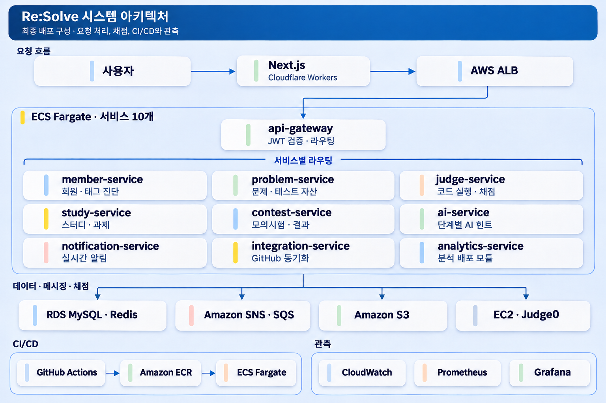

---

<a id="erd"></a>

## 🗃️ ERD

전체 ERD는 회원, 문제 회차, 제출, 스터디와 시험의 주요 관계를 보여줍니다. **FK**는 같은 서비스 안의 물리 외래 키, **ID 참조**는 서비스 간 논리 참조입니다.

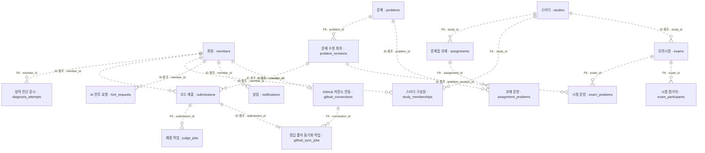

**서비스별 상세 ERD**

핵심 테이블에 한글 이름과 실제 테이블명, 주요 열과 제약을 표시합니다. 단일 열 고유 키는 `UK`, 여러 열을 묶는 고유 제약은 각 도메인의 **복합 UK**에 적습니다.

<details>
<summary>회원·인증 — member-service</summary>

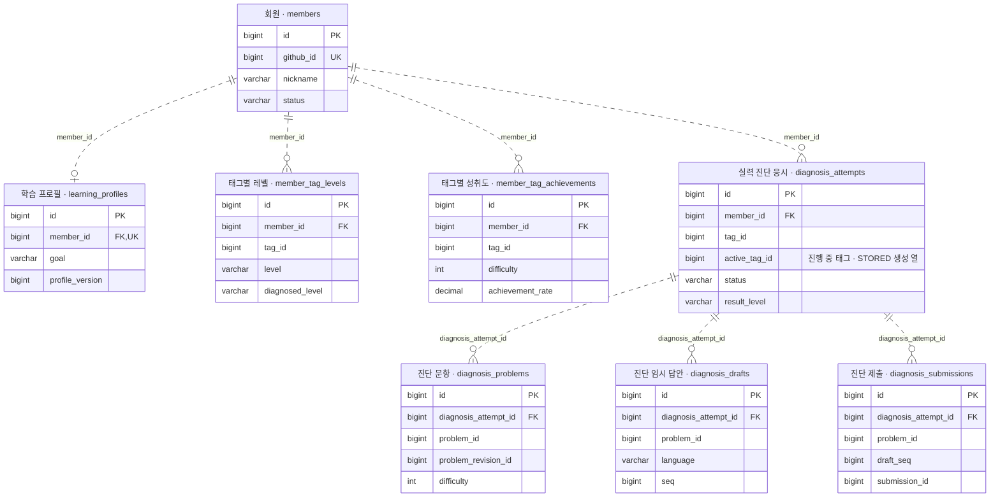

**복합 UK**

- `member_tag_achievements` · `(member_id, tag_id, difficulty)`
- `diagnosis_attempts` · `(member_id, active_tag_id)`
- `diagnosis_problems` · `(diagnosis_attempt_id, difficulty)`
- `diagnosis_drafts` · `(diagnosis_attempt_id, problem_id, language)`
- `diagnosis_submissions` · `(diagnosis_attempt_id, problem_id, draft_seq)`
- `member_tag_levels` · `(member_id, tag_id)`

</details>

<details>
<summary>문제·버전·테스트 자산 — problem-service</summary>

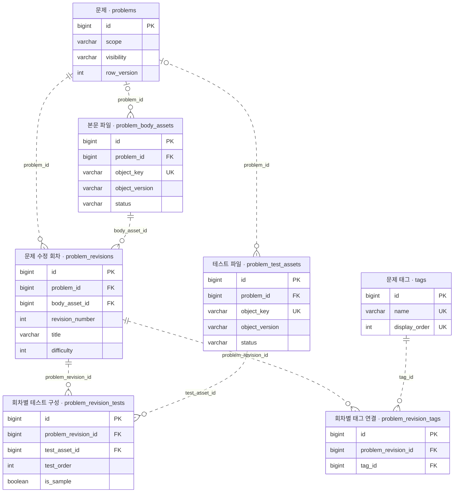

**복합 UK**

- `problem_revision_tests` · `(problem_revision_id, test_asset_id)` · `(problem_revision_id, test_order)`
- `problem_revision_tags` · `(problem_revision_id, tag_id)`
- `problem_revisions` · `(problem_id, revision_number)` · `(author_id, idempotency_key)`

</details>

<details>
<summary>채점·실행 작업 — judge-service</summary>

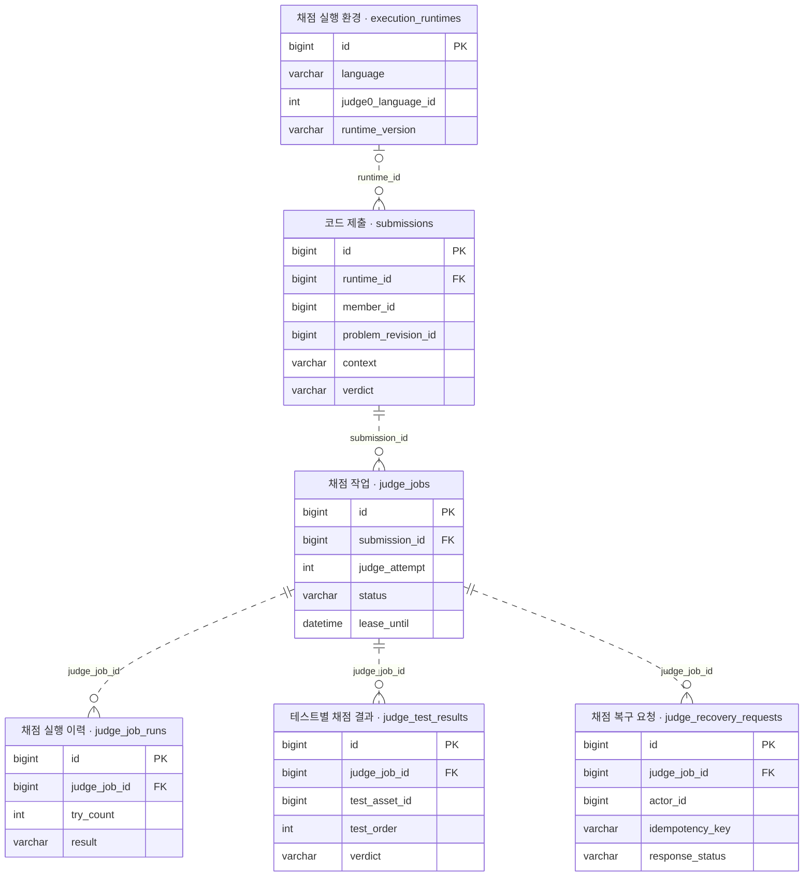

**복합 UK**

- `judge_recovery_requests` · `(actor_id, judge_job_id, idempotency_key)`
- `submissions` · `(member_id, idempotency_key)` · `(context, source_submission_id)`
- `judge_jobs` · `(submission_id, judge_attempt)`
- `judge_job_runs` · `(judge_job_id, try_count)`
- `judge_test_results` · `(judge_job_id, test_order)`

</details>

<details>
<summary>모의시험 — contest-service</summary>

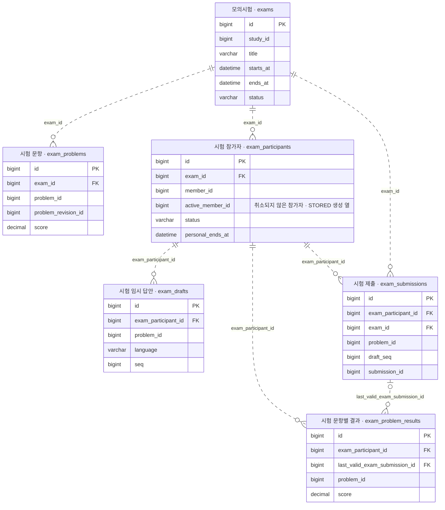

**복합 UK**

- `exam_drafts` · `(exam_participant_id, problem_id, language)`
- `exam_submissions` · `(exam_participant_id, problem_id, draft_seq)`
- `exam_problem_results` · `(exam_participant_id, problem_id)`
- `exam_problems` · `(exam_id, problem_id)`
- `exam_participants` · `(exam_id, active_member_id)`

</details>

<details>
<summary>스터디·과제 — study-service</summary>

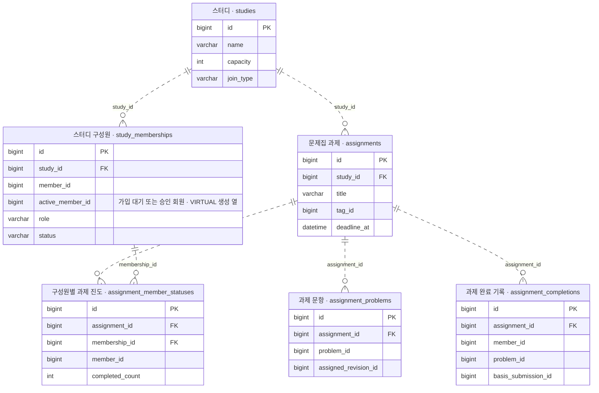

**복합 UK**

- `assignment_problems` · `(assignment_id, problem_id)`
- `assignment_member_statuses` · `(assignment_id, member_id)`
- `assignment_completions` · `(assignment_id, member_id, problem_id)`
- `study_memberships` · `(study_id, active_member_id)`

</details>

<details>
<summary>AI 힌트 — study-service 저장 영역</summary>

AI 힌트 생성은 `ai-service`가 담당하고 요청·사용량은 `study-service`에 저장됩니다.

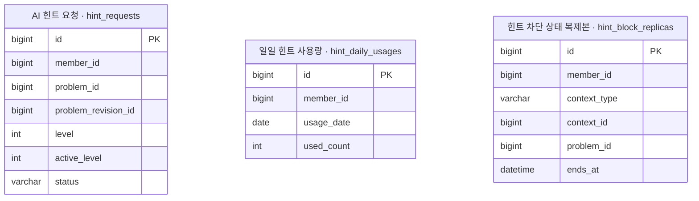

**복합 UK**

- `hint_requests` · `(member_id, problem_id, active_level)`
- `hint_daily_usages` · `(member_id, usage_date)`
- `hint_block_replicas` · `(member_id, context_type, context_id, problem_id)`

</details>

<details>
<summary>알림 — notification-service</summary>

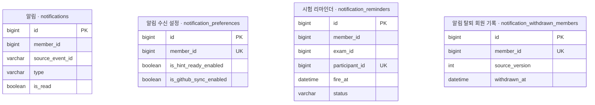

**복합 UK**

- `notifications` · `(source_event_id, member_id, type)`

</details>

<details>
<summary>GitHub 연동 — integration-service</summary>

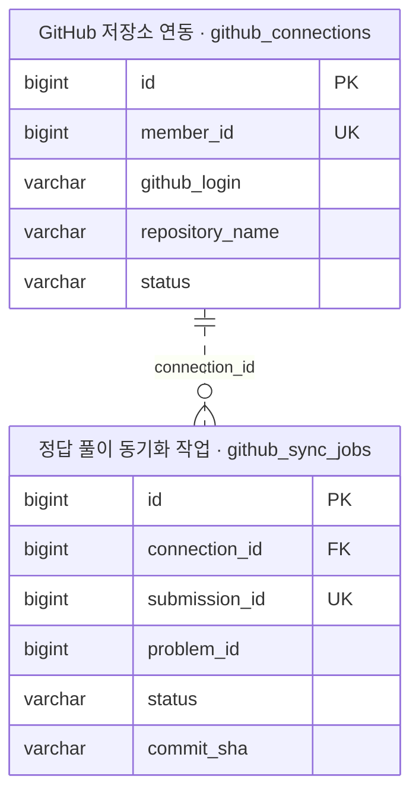

</details>

[도메인 및 데이터베이스 명세](docs/dev/specifications/erd.md)

---

<a id="api-spec"></a>

## 📖 API 명세서

[API 명세서](docs/dev/specifications/api-spec.md) · 문제·제출, 스터디, 시험 등 서비스별 요청과 응답

---

<a id="tech-stack"></a>

## 🧰 기술 스택

**Backend**

    

**Frontend**

    

**Data**

  

**Messaging · Judge**

  

**Infra · Deploy**

    

**Monitoring**

  

**Test**

    

**Code Quality**

 

---

<a id="core-technology"></a>

## ⚙️ 핵심 기술

**인증 전달과 알림 재연결**

- **사용자 식별** · API Gateway는 JWT를 검증한 뒤 사용자 식별 정보와 권한을 업무 서비스에 전달합니다.
- **알림 조회** · 브라우저가 SSE에 다시 연결하면 `Last-Event-ID`를 기준으로 이후 알림을 조회합니다.

**실행과 제출의 분리**

- **실행 환경** · 사용자 코드 실행과 채점은 별도 EC2의 Judge0에서 처리합니다.
- **일반 제출** · 워커는 `FOR UPDATE SKIP LOCKED`로 `judge_jobs`의 작업을 나눠 가져갑니다.
- **시험 제출** · 모의시험 채점 요청은 SQS를 거칩니다.

**시험 답안 저장과 마감**

- **문제 회차 고정** · 원본 문제가 수정되더라도 출제 시 지정한 회차로 응시합니다.
- **답안 복원** · 문항별 `seq`로 저장 순서를 관리해 응시 화면을 다시 열 때 마지막 저장본을 복원합니다.
- **마감 판단** · 응시 종료는 서버 시각을 기준으로 판단합니다.

**이벤트와 학습 기록**

- **이벤트 발행** · Outbox를 사용하는 서비스는 업무 데이터와 이벤트를 같은 트랜잭션에 기록하고, 서비스 간 이벤트는 SNS·SQS로 전달합니다.
- **결과 반영** · 채점 결과 이벤트는 스터디 진도와 시험 결과를 갱신하고, 정답 풀이의 GitHub 동기화에 사용됩니다.

**부하 검증과 관측**

- **k6** · 일반 제출, 시험 답안 저장·종료, 알림 SSE 등의 부하 시나리오를 실행합니다.
- **Grafana·CloudWatch** · API 응답 지연과 채점 대기는 Grafana에서, ECS의 CPU와 메모리는 CloudWatch에서 확인합니다.

---

<a id="project-structure"></a>

## 🗂️ 프로젝트 구조

```txt
re-solve/
├── frontend/               # 사용자 화면
├── api-gateway/            # 인증 토큰 검증과 요청 라우팅
├── member-service/         # 회원, 인증, 실력 진단
├── problem-service/        # 문제, 버전, 테스트 자산
├── judge-service/          # 코드 실행과 제출 채점
├── contest-service/        # 모의시험, 응시, 결과
├── study-service/          # 스터디, 과제, 진도
├── notification-service/   # 알림 저장과 SSE
├── integration-service/    # GitHub 연동
├── ai-service/             # 단계별 풀이 힌트
├── analytics-service/      # 분석용 배포 모듈
├── common-*/               # 백엔드 공통 모듈 5개
├── docs/                   # 설계·개발 문서
└── k6/                     # 부하 검증 시나리오
```

---

<a id="developer-guide"></a>

## 🛠️ 개발자 안내

**요구 사항** · Java 21, Docker, Docker Compose

**1. 환경 변수 설정**

저장소 루트에서 예시 파일을 복사합니다.

```bash
cp .env.example .env
```

DB, Redis, OAuth 설정은 환경 변수 안내를 따릅니다. [환경 변수 및 Judge0 설정](docs/operations/env-example.md)

**2. 백엔드와 인프라 실행**

```bash
./gradlew bootJar
docker compose up -d --build
docker compose ps
```

**3. 접속과 종료**

- **기본 로컬 화면** · `http://localhost:8080`
- **코드 실행과 채점** · Judge0 가동과 지원 언어 활성화가 필요합니다. [Judge0 가동 및 확인](docs/operations/env-example.md#5-judge0-%EC%B1%84%EC%A0%90-%EC%97%94%EC%A7%84-%EA%B0%80%EB%8F%99-%EB%B0%8F-%ED%99%95%EC%9D%B8)
- **종료** · `docker compose down`

<details>
<summary>프런트엔드 개발 모드</summary>

Node.js 24와 npm이 필요합니다. 로그인과 API 호출에는 백엔드 연결이 필요합니다.

```bash
cd frontend
npm ci
npm run dev
```

</details>

---

<a id="version-tags"></a>

## 🏷️ 버전 태그

- [**v0.2.0**](https://github.com/Back-To-Back-team-3/re-solve/tree/v0.2.0) · 최신 Git 태그
- [v0.1.0](https://github.com/Back-To-Back-team-3/re-solve/tree/v0.1.0) · 이전 Git 태그

---

<a id="related-docs"></a>

## 📚 관련 문서

**설계와 계약**

- [기획서 v1.0](docs/dev/planning/planning.md) · 서비스의 주요 이용 시나리오와 핵심 기능
- [이벤트 계약서](docs/dev/specifications/event-contract.md) · 이벤트 형식과 서비스 간 전달 규칙
- [공통 타입 명세](docs/dev/specifications/type-spec.md) · 채점 함수의 입력·반환 타입과 언어별 매핑

**개발과 검증**

- [채점 실행 가이드](docs/guides/judge-execution.md) · Judge0 요청 생성과 결과 변환
- [공통 모듈 적용 가이드](docs/guides/common-module.md) · 기존 서비스에 공통 기능 적용
- [컨벤션·빌드 매뉴얼](docs/guides/convention-build-manual.md) · 코드 스타일과 빌드 확인
- [k6 실행 안내](k6/README.md) · 부하 검증 시나리오와 실행 방법

[전체 개발 문서 목록](docs/README.md)
